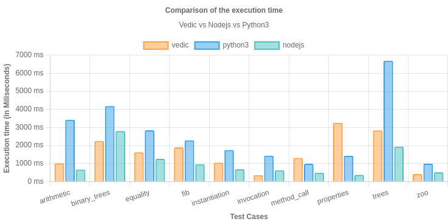

<p align="center">
    <a href="https://vedic-lang.github.io">
        
    </a>
    <br>
    <a href="https://vedic-lang.github.io/download">Download</a> ·
    <a href="https://vedic-lang.github.io/">Documentation</a> ·
    <a href="https://vedic-lang.github.io/vedic-ide">Online Ide</a>
    <br><br>
    <i>Loved the tool? Please consider <a href="https://paypal.me/ptprashanttripathi/10">donating</a> to help it improve!</i>
    <br>
	<a href="https://paypal.me/PtPrashantTripathi">
        
    </a>
	<a href='https://ko-fi.com/ptprashanttripathi' target='_blank'>
        
    </a>
<a href="https://app.fossa.com/projects/git%2Bgithub.com%2Fvedic-lang%2Fvedic?ref=badge_shield" alt="FOSSA Status"></a>
	<a href="https://www.buymeacoffee.com/ptprashant09" target="_blank">
        
    </a>
</p>

## Vedic Programming Language

> Introducing **Vedic** 🎉 - A Sanskrit programming language interpreter written in Rust! 🎉 Designed for simplicity and power, Vedic allows developers to write modern programs in the ancient language of Sanskrit.

## 👨‍💻 Installation

The Vedic CLI is available for macOS, Linux, and Windows.

### Download and install

Visit the [Download page](https://vedic-lang.github.io/download), which offers convenient scripts for downloading and installing the binary.

### Install with APT on Debian and Ubuntu

On Debian 13 or Ubuntu 24.04 for amd64 (64-bit Intel or AMD), add the Vedic repository and install the CLI. The source file includes the key APT uses to verify updates.

```sh
curl -fsSLo vedic.sources https://vedic-lang.github.io/apt/vedic.sources
sudo install -m 0644 vedic.sources /etc/apt/sources.list.d/vedic.sources
sudo apt update
sudo apt install vedic
vedic --version
```

[APT repository and signing information](https://vedic-lang.github.io/apt/)

### Using Shell (Linux and macOS):

```bash
curl -fsSL https://vedic-lang.github.io/install/install.sh | bash
```

### Using Homebrew (Linux and macOS):

```bash
brew install vedic
```

## 📖 Documentation

Read the [Vedic language reference](https://vedic-lang.github.io/language-reference) for syntax and semantics, or browse the full [documentation](https://vedic-lang.github.io/).

Format a source file, or recursively format Vedic files in a directory, with the CLI:

```bash
vedic format path/to/file.ved
vedic format path/to/examples
```

## 📊 Benchmarks

<p align="center"><a href="https://vedic-lang.github.io/benchmarks"></a></p>

## 🌐 Community

**Join us on Discord**

<p><a href="https://discord.gg/sWCHauhNQ2"></a></p>

## 👤 Author

<p><a href="https://github.com/ptprashanttripathi"></a></p>

[**Pt. Prashant Tripathi**](https://github.com/ptprashanttripathi)

[Github](https://github.com/ptprashanttripathi) · [Twitter](https://twitter.com/ptprashant09) · [LinkedIn](https://www.linkedin.com/in/ptprashanttripathi/)

## 🤝 Contributing

Contributions, issues and feature requests are welcome!<br />Feel free to check [Contributing Guide](https://github.com/vedic-lang/vedic/blob/main/CONTRIBUTING.md).

## 👍 Show your support

Give a ⭐️ if this project helped you!

## 📝 License

Copyright © 2022 [Pt. Prashant Tripathi](https://github.com/ptprashanttripathi).<br />
This project is [MIT](https://github.com/vedic-lang/vedic/blob/main/LICENSE) licensed.

---

_Developed with ❤️ in India 🇮🇳_


[](https://app.fossa.com/projects/git%2Bgithub.com%2Fvedic-lang%2Fvedic?ref=badge_large)
